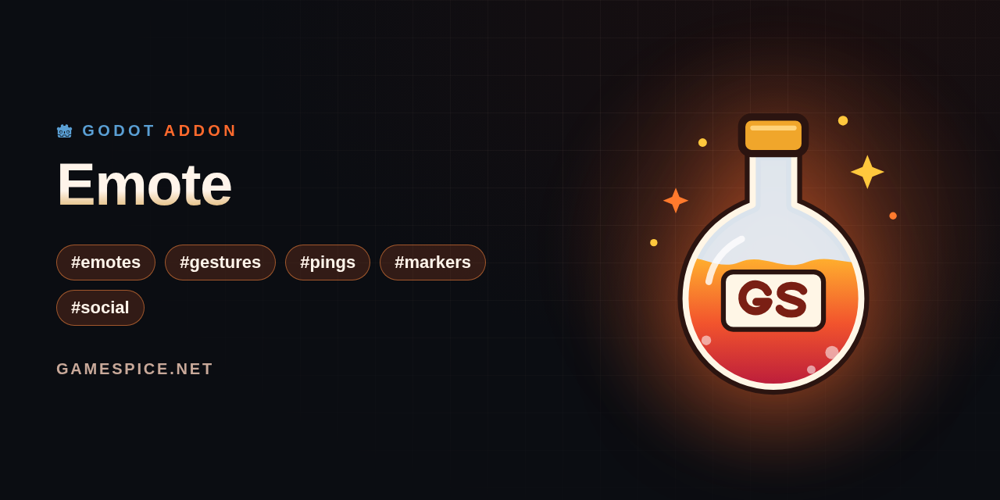

[](https://moddingcommunity.com/a/147-gs-emote)

Godot 4.7+ addon for emotes, gestures, sprays, pings and map markers: a catalogue, a radial wheel model, server-validated equip and cooldowns. Part of the GameSpice addon family.

This GameSpice addon is MIT licensed, built with Claude Code, and has a headless self-test (`res://examples/emote_selftest.tscn`). The games in [Zee's Games](https://zeesgames.com) are built on the GameSpice addons and run on live servers. The assets keep improving through Nightly.

## Install

1. Copy `addons/gs_emote/` and `addons/gs_core/` into your project.
2. Enable the addon in *Project > Project Settings > Plugins*.

It needs only GameSpice Core ([gs_core](https://github.com/gamespice-platform/core)).

## Quick start

```gdscript
var cfg := GSEmoteConfig.from_files().value as GSEmoteConfig
var cat := GSEmoteCatalogue.new()
cat.add({"id": "wave", "kind": "emote", "duration": 1.2})
cat.add({"id": "enemy_spotted", "kind": "ping"})

var wheel := GSEmoteWheel.from_config(cfg)          # slot 0 is up, slots run clockwise
wheel.equip(0, &"wave", cat)
var slot := wheel.slot_at(stick_offset)              # -1 inside the deadzone

var gate := GSEmoteGate.new(cfg, cat)               # server side; time is passed in
gate.set_equipped(peer_id, wheel.equipped())
var ok := gate.use(peer_id, &"wave", now)            # FORBIDDEN if not equipped, RATE_LIMITED inside the cooldown
gate.ping(peer_id, &"enemy_spotted", now)
gate.place_marker(peer_id, &"enemy_spotted", hit_point, now)   # QUOTA at markers_per_player
```

## Settings

Every number is a field on `GSEmoteConfig`. The values below are defaults, and the ranges are inspector slider limits, not enforced caps. Set the property from code or a config file (`cfg/addon/gs_emote/emote.yml`, `GS_EMOTE_*`, `--emote-*`) to go beyond them. A bad value fails loudly in `validate()`.

| Setting | Default | What it does |
| --- | --- | --- |
| `enabled` | true | Master switch: off, the gate refuses every use, ping and marker. |
| `wheel_slots` | 8 | Slots on the radial wheel. |
| `wheel_deadzone` | 0.25 | Stick or mouse distance (0 to 1) under which no slot is picked. |
| `key` | "G" | Key that opens the wheel (the game binds it). |
| `emote_cooldown` | 1.5 | Seconds between two emotes by one player; 0 is no cooldown. |
| `ping_cooldown` | 0.4 | Seconds between two pings by one player; 0 is no cooldown. |
| `ping_burst` | 4 | Pings one player may send inside `ping_window`; 0 is unlimited. |
| `ping_window` | 6.0 | Seconds the ping burst is counted over. |
| `markers_per_player` | 4 | Map markers one player may keep at once; 0 is unlimited. |
| `marker_ttl` | 30.0 | Seconds a marker lives; 0 never expires. |
| `cancel_on_move` | true | Moving ends the emote in progress. |
| `default_duration` | 2.0 | Seconds an emote with no duration plays; 0 holds until cancelled. |

## What it is not

- Not art, audio or animation: a catalogue entry names a clip, spray or sound, it does not play one.
- Not a chat or voice system.
- Not a loadout or inventory: it validates an equipped list it is given, it does not own where that list is stored.
- Not a renderer for markers: it keeps the data (who, where, until when), the game draws them.

## Test

```bash
godot --headless --path . --import
godot --headless --path . res://examples/emote_selftest.tscn
```

The self-test is offline and exits non-zero on any failure.

## Used by

No shipped game vendors it yet. The example scene shows it. The whole collection is at [zeesgames.com](https://zeesgames.com).

## Licence

MIT. See [LICENSE](LICENSE). Only the TMC back-end web infrastructure is not open source.
